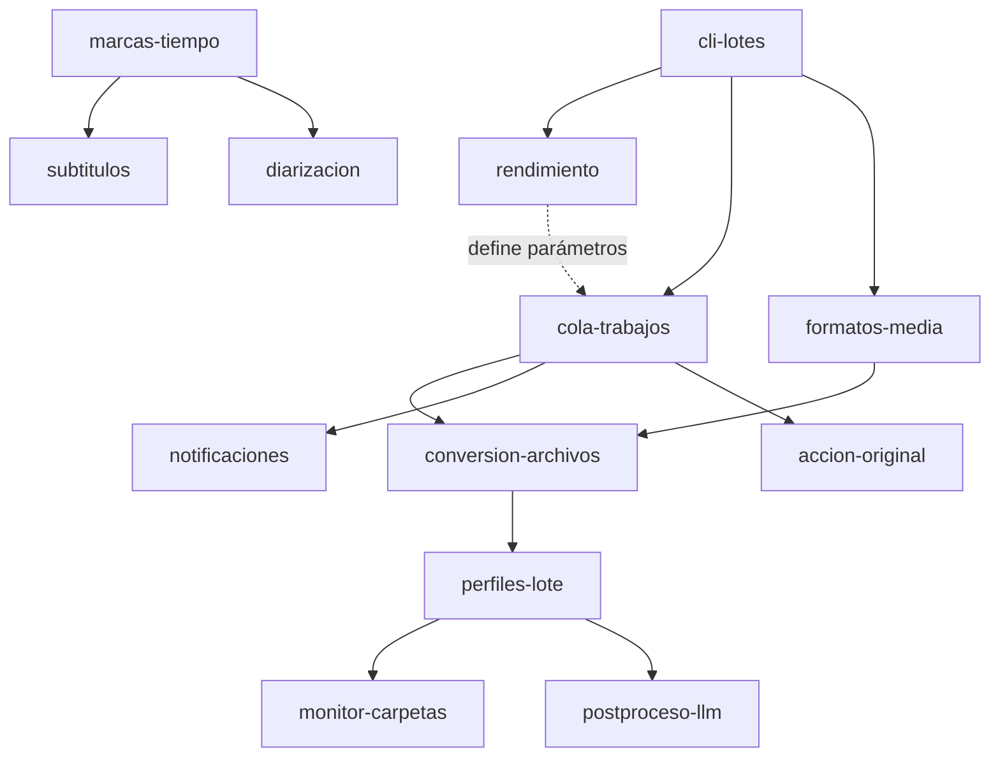

# Mapa de funcionalidades

Claves usadas en ramas (`feat/<clave>`), archivos y conversaciones.

## Dependencias

Una flecha `A --> B` significa "B usa servicios de A" (A es base de B).

## Funcionalidades

| Clave                                                            | Tipo     | Depende de                    | Da servicio a                                        |
| ---------------------------------------------------------------- | -------- | ----------------------------- | ---------------------------------------------------- |
| [cli-lotes](funcionalidades/cli-lotes.md)                        | Base     | —                             | rendimiento, cola-trabajos, formatos-media           |
| [rendimiento](funcionalidades/rendimiento.md)                    | Base     | cli-lotes                     | cola-trabajos (concurrencia, audios largos)          |
| [cola-trabajos](funcionalidades/cola-trabajos.md)                | Base     | cli-lotes                     | conversion-archivos, notificaciones, accion-original |
| [formatos-media](funcionalidades/formatos-media.md)              | Base     | cli-lotes                     | conversion-archivos, monitor-carpetas                |
| [conversion-archivos](funcionalidades/conversion-archivos.md)    | Usuario  | cola-trabajos, formatos-media | perfiles-lote                                        |
| [perfiles-lote](funcionalidades/perfiles-lote.md)                | Usuario  | conversion-archivos           | monitor-carpetas, postproceso-llm                    |
| [monitor-carpetas](funcionalidades/monitor-carpetas.md)          | Usuario  | perfiles-lote                 | —                                                    |
| [marcas-tiempo](funcionalidades/marcas-tiempo.md)                | Base     | cola-trabajos                 | subtitulos, diarizacion                              |
| [subtitulos](funcionalidades/opcionales.md#subtitulos)           | Opcional | marcas-tiempo                 | —                                                    |
| [diarizacion](funcionalidades/diarizacion.md)                    | Usuario  | marcas-tiempo                 | —                                                    |
| [notificaciones](funcionalidades/opcionales.md#notificaciones)   | Opcional | cola-trabajos                 | —                                                    |
| [accion-original](funcionalidades/opcionales.md#accion-original) | Opcional | cola-trabajos                 | —                                                    |
| [postproceso-llm](funcionalidades/opcionales.md#postproceso-llm) | Opcional | perfiles-lote                 | —                                                    |

## Orden de trabajo

1. **cli-lotes**: probar en Windows lo ya instalado y mergear a `main`.
2. **rendimiento**: medir audios largos antes de diseñar el resto.
3. **cola-trabajos**, en paralelo con **formatos-media** (no comparten código).
4. **conversion-archivos** → **perfiles-lote** → **monitor-carpetas**.
5. **marcas-tiempo** → **subtitulos**.
6. **diarizacion** (última: la más incierta).

Los opcionales (notificaciones, accion-original, postproceso-llm) se
intercalan cuando su dependencia esté en `main`.

## Decisiones globales

| Fecha      | Decisión                                                                                                           | Motivo                                                                                         |
| ---------- | ------------------------------------------------------------------------------------------------------------------ | ---------------------------------------------------------------------------------------------- |
| 2026-10-13 | Traspaso de conocimiento en `docs/fork/` dentro del repo.                                                          | Viaja con el código; lo lee cualquier sesión sin herramientas extra.                           |
| 2026-10-13 | Un commit por funcionalidad en `main` (squash merge).                                                              | Historial legible y fácil de revertir.                                                         |
| 2026-10-13 | No se toca el historial estándar de Handy; cola-trabajos lleva su propio registro de archivos de entrada y salida. | Es funcionalidad de upstream; mezclar lotes con dictados lo ensucia y su límite rota entradas. |
| 2026-10-13 | Palabras personalizadas: un único diccionario global.                                                              | Simplicidad.                                                                                   |
| 2026-10-13 | Todo extra es opcional y se activa desde la configuración.                                                         | Por defecto, Handy se comporta como upstream.                                                  |
| 2026-10-13 | Código nuevo en módulos nuevos; enganche mínimo en archivos de upstream.                                           | Merges de upstream sin conflictos.                                                             |
| 2026-10-13 | **Pendiente de confirmación:** esquema de ramas de [README](README.md#ramas).                                      | —                                                                                              |
